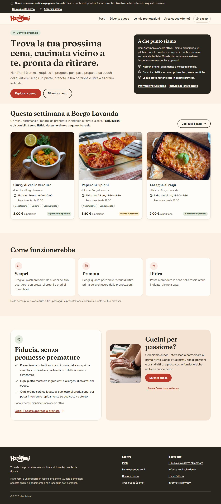

# HamiYami — marketplace demo

> **Trova la tua prossima cena, cucinata vicino a te, pronta da ritirare.**
> *Find your next dinner, cooked nearby, ready for pickup.*

HamiYami is a planned marketplace for meals prepared by neighborhood cooks in Italy. This repository is a **publicly deployable demo** of the core experience for a first pilot: one neighborhood, a few cooks, a limited weekly menu, preorders and scheduled pickup.

> **Status: prelaunch demo.** Every meal, cook, neighborhood and availability figure is fictional. There are no real orders, payments, accounts or messages, and no database. Visitors' demo actions are stored only in their own browser. Real waitlist collection exists in the code but is **off** and cannot be switched on until the requirements in [Before a real pilot](#before-a-real-pilot) are met.



## Contents

- [What the demo shows](#what-the-demo-shows)
- [Run, build and test](#run-build-and-test)
- [How demo state works](#how-demo-state-works)
- [Application structure](#application-structure)
- [Domain rules](#domain-rules)
- [Configuration](#configuration)
- [Security: what is in place and what is missing](#security-what-is-in-place-and-what-is-missing)
- [Connecting a database](#connecting-a-database)
- [Checklists](#checklists)
- [Content rules](#content-rules)
- [Brand assets and images](#brand-assets-and-images)
- [Accessibility and responsive behavior](#accessibility-and-responsive-behavior)
- [Verification](#verification)
- [Known limitations](#known-limitations)

## What the demo shows

| Journey | Where | What it demonstrates |
|---|---|---|
| Homepage | `/it` | The dinner use case, prelaunch status, this week's meals, how it would work, a short trust summary, the cook journey |
| Meal discovery | `/it/meals` | Weekly menu for the pilot neighborhood, grouped by pickup day; each card says when reservations close (Rome time); day, neighborhood, dietary-preference and price filters (kept in the URL); empty states; fictional availability |
| Meal details | `/it/meals/{offering}` | Photo or neutral placeholder, portion, ingredients, declared allergens and possible cross-contact (kept apart from dietary preferences), cook, pickup window and area, quantity, sold-out and closed states |
| Simulated reservation | `/it/meals/{offering}/reserve` | Portions → pickup time → review → demo confirmation. No payment, no account, no personal details. Double-submit and Back-button safe |
| My reservations | `/it/reservations` | View and cancel simulated reservations until the cut-off; each upcoming one has a pickup code and an "Add to calendar" (.ics) link built in the browser |
| Cook profile | `/it/cooks/{cook}` | Clearly fictional profile, cooking style, sample menu, upcoming demo dates, and *no* verification claims, ratings or testimonials |
| Cook workspace | `/it/cook-workspace` | A labelled **simulation** of a fictional cook's tools. It opens on a day-by-day **prep view** (portions to cook, requests to confirm, still free, and the pickup list with codes, where reservations are confirmed or declined), then dates (publish/unpublish, edit) and dishes (create, edit) |
| Become a cook / Waitlist | `/it/become-a-cook`, `/it/waitlist` | Interest form with shared validation; while collection is off it says plainly that nothing was sent |
| Trust | `/it/trust` | The *planned* food-safety approach, future-facing only |
| About the demo, Privacy | `/it/demo`, `/it/privacy` | What is and isn't real; the privacy notice placeholder |

Italian is the default language (`/it/…`); English is at `/en/…`. The language switch keeps the current page and filters.

Deliberately left out: delivery, subscriptions, chat, AI recommendations, ratings, real accounts and payments.

## Run, build and test

Requires **Node.js 22.12+** (developed on Node 24 LTS) and npm.

```bash
npm ci
```

```bash
npm run dev
```

Opens the app at http://localhost:3000 (redirects to `/it`).

| Script | What it does |
|---|---|
| `npm run dev` | Development server |
| `npm run build` / `npm start` | Production build / serve it |
| `npm run typecheck` | Generates route types (`next typegen`) and runs `tsc --noEmit` (strict) |
| `npm run lint` | ESLint (Next.js core-web-vitals + TypeScript rules, plus a rule that screens may not import fixtures) |
| `npm test` | Unit tests (Vitest): domain, data layer, forms, waitlist server, translations, CSP |
| `npm run test:e2e` | Browser tests (Playwright) against a production build on port 3100 |
| `npm run check` | typecheck + lint + unit tests + build |
| `npm run og-image` | Re-renders the social sharing image with a local Edge or Chrome |

Browser tests need a Chromium browser. Either use an installed one:

```bash
PLAYWRIGHT_CHANNEL=chrome npm run test:e2e
```

or download Playwright's own once with `npx playwright install chromium`. Set `E2E_SKIP_BUILD=1` to reuse an existing build. The tests start the server with real collection forced off.

## How demo state works

- **The catalog** (neighborhoods, cooks, dishes, the weekly menu, sample reservations by fictional customers) is fixture data in `src/data/fixtures/`. The server renders pages from it, identical for every visitor.
- **Dates never expire.** The weekly menu is generated for the seven days after *today in Europe/Rome*, from a weekday schedule (`weekly-menu.ts`). Offering ids include the date (`off-lasagna-thu-2026-10-29`), so they are stable for the day. The server passes its "today" to the browser so both render the same dates.
- **Visitor changes** (simulated reservations, cook workspace dishes and dates, cook decisions on sample reservations) live only in that browser's `localStorage` under `hamiyami.demo`. They overlay the catalog in the browser: a dish published in the workspace appears in that visitor's discovery; a reservation lowers that visitor's availability. Nothing is sent to a server, so **nothing is shared between visitors**.
- **Safe parsing and versioning.** Stored data is validated with Zod on every load (`demo-state.ts`). Unreadable or tampered data, or data from another schema version, is discarded and the visitor sees a notice. Size limits cap stored lists. If storage is blocked, the demo keeps working in memory and says so.
- **Reset.** "Azzera la demo / Reset the demo" in the top banner (and on `/demo`) asks for confirmation and clears everything stored.
- **Checkout attempts** keep a random idempotency key in `sessionStorage` (no personal data), so double clicks, reloads or going Back and confirming the same choice never create a second reservation.
- **Pickup codes** are derived from the reservation id (`domain/pickup-code.ts`), so they need no stored field: consonants and digits only, never a word. The customer's page and the cook's pickup list show the same code.
- **Calendar files** are built in the browser as a `data:` link (`features/reservations/calendar.ts`): RFC 5545, UTC times, a one-hour reminder. Downloading one sends nothing anywhere.
- **No personal data** is requested or stored by the demo. Discovery filters in the URL are non-personal.

## Application structure

One Next.js App Router application, organized by feature:

```
src/
  app/[locale]/           routes (server components); layout adds providers, banner, header, footer
  app/api/waitlist/       POST /api/waitlist (real collection only when fully configured)
  proxy.ts                locale redirect + per-request nonce Content-Security-Policy
  domain/                 types, Zod schemas and rules: money, Rome time, catalog, offering, reservation, pickup code
  data/
    contracts.ts          data-access interfaces used by everything above
    fixtures/             fictional catalog and weekly menu (imported only inside src/data)
    demo/                 demo implementation: seed builder, versioned browser store, repositories, React provider
    server/catalog.ts     server-side, read-only catalog (swap for a database implementation)
  features/
    meals/                discovery and detail queries + components (cards, filters, detail)
    cooks/                cook profile query + components
    reservations/         reservation flow, list, detail, pickup pass, calendar export, idempotency attempt keys
    cook-workspace/       form schemas, prep plan, editors, workspace view
    waitlist/             shared schema, approved consent registry, form
  server/                 server-only: env validation, CSP builder, waitlist handler/store/rate limit
  i18n/                   locales, dictionaries (it = shape, en typed against it), formatting helpers
  shared/                 design tokens, global CSS, UI primitives, layout shell
tests/unit/               Vitest
tests/e2e/                Playwright
supabase/schema.sql       table for real waitlist signups (insert-only)
```

Layering: **screens → application functions (`features/*`) → contracts (`data/contracts.ts`) → implementation (`data/demo`, `data/server`)**. Components never import fixtures (enforced by ESLint) and contain no storage-specific code. Server components render from `getServerCatalog()`; client components re-run the same application functions against the visitor's demo repositories through `useDemoQuery`, starting from the server-rendered data so first paint matches.

Dependencies are deliberately few: `next`, `react`, `react-dom`, `zod`, `server-only`; dev: TypeScript 6, ESLint 9 + `eslint-config-next`, Vitest, Playwright. Styling is CSS Modules on shared tokens (`src/shared/styles/tokens.css`). TypeScript 7 is not used yet because `typescript-eslint` supports TypeScript < 6.1.

## Domain rules

- **Money** is integer cents with an explicit currency (`EUR`), parsed from typed input without floating-point maths (`domain/money.ts`).
- **Time:** pickup dates are Europe/Rome civil dates and pickup windows are Rome wall-clock times, whatever the visitor's device time zone. Instants are used only for cut-offs. Windows must fall between 07:00 and 23:00, so DST changes (02:00–03:00) can never create missing or repeated pickup times. Tests cover the October 2026 clock change.
- **Offering:** dish, cook, neighborhood, pickup point (general area only), date, window, price, capacity (1–60), max per reservation (1–8, ≤ capacity), cut-off (hours before pickup), published/unpublished.
- **Capacity:** portions held by reservations in `requested`, `confirmed`, `collected` or `not_collected` count against capacity; cancelled/declined ones release it. A reservation takes 1…min(remaining, max per reservation). A cook cannot lower capacity below portions already held. Reservations close at the cut-off.
- **Reservation:** quantity, **price snapshot** (later price edits don't change it), pickup snapshot, status, history, idempotency key. States and transitions (`domain/reservation.ts`):

  ```
  requested ─cook→ confirmed ─cook→ collected | not_collected   (only once pickup has started)
  requested ─cook→ declined_by_cook
  requested | confirmed ─customer→ cancelled_by_customer        (only before the cut-off)
  ```
- **Food information:** allergens use the 14 EU Regulation 1169/2011 Annex II categories, with "may contain" kept separately. Dietary preferences (vegetarian, vegan, pork-free) are a browsing aid and are never presented as excluding allergens or cross-contact; every place they appear says so.

## Configuration

Copy `.env.example` to `.env.local` for local work. **With nothing set, the site runs as the public demo.** None of these variables is exposed to the browser (no `NEXT_PUBLIC_` prefix).

| Variable | Purpose |
|---|---|
| `SITE_URL` | Optional public address; enables Open Graph sharing previews |
| `WAITLIST_COLLECTION_ENABLED` | `true` turns on real signup storage. Default off |
| `PRIVACY_NOTICE_PUBLISHED` | Operator confirmation that a real notice is live at `/privacy` |
| `SUPABASE_URL`, `SUPABASE_SECRET_KEY` | Storage for signups (server-side secret key) |
| `WAITLIST_ALLOWED_ORIGINS` | Origins allowed to post the form |
| `WAITLIST_RATE_LIMIT` | `platform` (a durable limit configured in front of the app) or `memory-dev` (local only; refused in production) |

Configuration is validated when `next.config.ts` loads. If collection is enabled and anything is missing or invalid, **the build and server start fail** with a list of the problems (names only, never values). There is no half-working mode.

## Security: what is in place and what is missing

TypeScript is not a security boundary: all external input is validated at runtime with Zod, on the server for anything that would be stored.

**In place**

- **Content-Security-Policy** with a fresh nonce per request (`src/proxy.ts`, `server/security/csp.ts`): scripts only from this origin with the nonce and `strict-dynamic`; no `unsafe-eval` in production; same-origin images, fonts and connections; `object-src 'none'`, `base-uri 'self'`, `form-action 'self'`, `frame-ancestors 'none'`. Inline style *attributes* are allowed for `next/image`. This requires dynamic rendering of every page (see limitations).
- Other headers (`next.config.ts`): `X-Content-Type-Options`, `Referrer-Policy`, `X-Frame-Options: DENY`, `Permissions-Policy`, `Cross-Origin-Opener-Policy`, HSTS; `X-Powered-By` removed.
- **Waitlist signup** (`server/waitlist/`):
  - One Zod schema (`features/waitlist/schema.ts`) for browser feedback and server authority. Rules are no longer duplicated by hand.
  - **Consent wording and version are resolved on the server** from an approved registry (`features/waitlist/consent.ts`). Browser-sent wording is ignored; unknown versions are rejected.
  - **Insert-only storage:** an unverified repeat submission can never alter an existing (email, audience) record. Supabase is called with `resolution=ignore-duplicates`, and a database trigger blocks updates as defence in depth.
  - **No account enumeration:** new and repeat signups get the same `{ ok: true }`.
  - Outbound storage requests **time out after 5 s**; the browser request times out after 15 s.
  - Content type, body size (10 kB), origin allow-list, honeypot and minimum fill time are checked. These are **supplementary** controls, not authentication or rate limiting.
  - **Rate limiting** goes through a `RateLimiter` interface checked before any work. Production must use a durable limit (`platform`, e.g. a Vercel Firewall rule on `/api/waitlist`). The in-memory limiter is development-only, documented as non-durable on serverless hosting, and refused in production.
  - Logs carry a failure kind or HTTP status only, never submitted values. Responses are `Cache-Control: no-store`.
  - A success message appears **only** after the server answers `{ ok: true }`. While collection is off the form makes no request and says nothing was sent; the API answers `503 not_configured`.
- Secrets exist only in server code (`server-only` imports; no public env vars).
- No analytics, trackers or third-party requests. Fonts and images are self-hosted. (The old landing page's disabled analytics hook was removed; add one only for non-sensitive product events, after a consent review.)
- **Demo boundaries:** the cook workspace has no login and no role switch. It is labelled a simulation everywhere and must never be reused as authorization. Visitor data stays in the browser and contains no personal data.

**Missing before real use** (see [Before a real pilot](#before-a-real-pilot)): authentication, server-side authorization and ownership checks, email verification (double opt-in), a durable rate limiter, a real privacy notice and operator details, monitoring, and backups.

## Connecting a database

The contracts in `src/data/contracts.ts` are the seam: screens and application functions keep working against a new implementation. This is **not** a one-click swap. A real backend needs:

1. **Schema and migrations.** Tables for neighborhoods, pickup points, cooks, meals (with allergen/dietary columns), offerings, reservations (with status history and price snapshot) and signups. Use versioned migrations (e.g. Supabase CLI) and constraints that mirror the domain: money as integer cents + currency, `capacity > 0`, `max_per_reservation <= capacity`, status enums, `unique (customer_id, idempotency_key)`.
2. **Server-side implementations** of `CatalogRepository`, `ReservationRepository` and `CookWorkspaceRepository` (in `src/data/server/`), called from server components and from Server Actions or route handlers for mutations. Replace `getServerCatalog()` first: public browsing then works unchanged.
3. **Authentication** for customers and cooks (e.g. Supabase Auth or another provider). The demo has none.
4. **Authorization on the server, for every operation:**
   - customers can read and change only their own reservations; the customer id comes from the session, never from the request body;
   - cooks can create and edit only their own meals and offerings, and see only reservations for their offerings;
   - cook status changes (confirm, decline, collected) only for their own offerings, following the transition rules in `domain/reservation.ts`;
   - administrative actions (onboarding checks, suspending sales, recalls) restricted to an admin role and audited;
   - with Supabase, enforce this with Row Level Security policies as well as in the server code.
5. **Atomic inventory and idempotency.** Creating a reservation must check capacity and insert in one transaction, e.g. a conditional update (`update offerings set reserved = reserved + :q where id = :id and reserved + :q <= capacity and status = 'published' and now() < cutoff`) or row locking, plus a unique idempotency key that returns the existing reservation on retry. The browser-side checks in the demo are not sufficient under concurrency. Generate the **pickup code** on the server at the same time, unique among the reservations for that offering (the demo derives it from the id).
6. **Remove the demo overlay** (`src/data/demo/`, `DemoProvider`, `useDemoQuery`) once real data flows from the server, or keep it behind a "demo mode" flag. Client components then refresh with server data (e.g. `router.refresh()` after a Server Action) instead of browser storage.
7. **Payments** (if and when chosen): a provider's hosted checkout, webhooks verified on the server, and reservations confirmed only after payment confirmation.
8. **Images:** a storage bucket with upload validation (type, size, dimensions), moderation, and rights confirmation from cooks.
9. **Operations:** backups, monitoring and alerting, structured logs without personal data, data-retention jobs, and an incident and recall process tied to orders and batches.

## Checklists

### Public demo (no database)

- [ ] `npm run check` and `npm run test:e2e` pass.
- [ ] `WAITLIST_COLLECTION_ENABLED` unset or `false` (the default).
- [ ] Optionally set `SITE_URL` for sharing previews.
- [ ] Keep `robots: noindex` (in `src/app/[locale]/layout.tsx`) unless you want the demo indexed.
- [ ] Confirm the photo licences still suit your use (see [Images](#brand-assets-and-images)).
- [ ] Deploy (e.g. Vercel). No secrets are needed.

### Before a real pilot

- [ ] **Legal operator details:** the legal entity, contact details and, if required, DPO contact. None are invented here.
- [ ] **A real Privacy Notice** at `/privacy` (replace the placeholder), covering at least (GDPR Art. 13): controller identity and contact; purposes and legal bases (waitlist/cook interest; marketing by consent, if kept); data categories; recipients and processors (hosting, database, email, any others) and transfers outside the EU with safeguards; retention; data-subject rights and the right to complain to the Garante per la protezione dei dati personali; how to unsubscribe and request deletion. Have it reviewed by someone qualified. Then set `PRIVACY_NOTICE_PUBLISHED=true`.
- [ ] **Email verification** (double opt-in) before using marketing consent, and a verified flow for changing or deleting a signup (the insert-only trigger will need a controlled exception).
- [ ] **Durable rate limiting** in front of `/api/waitlist`, then `WAITLIST_RATE_LIMIT=platform`. Consider a CAPTCHA (e.g. Cloudflare Turnstile) if spam appears; CSP would need its domains.
- [ ] Supabase project in an EU region, `supabase/schema.sql` applied, secret key stored only in the host's environment settings. Submit a test signup, check the row, delete it.
- [ ] Database integration as described above, with authentication, authorization, atomic inventory and idempotency.
- [ ] **Food-safety processes** confirmed by a qualified professional before any statement on `/trust` changes from planned to operational. Real onboarding checks only, with evidence.
- [ ] Cook onboarding that verifies applicable food-business requirements; terms for cooks and customers; allergen information procedures.
- [ ] Payment provider (if used), refunds and cancellation policy.
- [ ] Monitoring, backups, incident and recall procedures, data retention.
- [ ] Remove the fictional catalog, demo banner and demo storage, and remove `noindex`.

## Content rules

- **Never imply** that orders are real, payments are accepted, cooks are verified, inventory is shared, demo reservations reach a cook, or food-safety processes are operational. Don't add ratings, testimonials, counts, partners, a launch city or date, or legal/licensing claims unless they are real and evidenced. A unit test scans both dictionaries for banned claims.
- **Trust / food-safety page** (`/trust`, carried over from the original landing page). Everything describes a plan:
  - Keep future-facing wording ("we plan to", "proposed", "will"). Never describe checks, records or recalls as happening.
  - Never use: "100% safe", "guaranteed hygiene", "government-approved kitchens", "certified by HamiYami", "every meal inspected", "AI-verified food safety".
  - Don't claim that photos prove a meal is safe, or that provider agreements remove HamiYami's responsibility.
  - Keep the closing disclaimer: *"These are planned processes, subject to professional review and pilot validation. No verification process can eliminate every food-safety risk."*
  - When a process actually starts running, update its wording here and in the homepage trust summary at the same time.
- **Translations** live in `src/i18n/dictionaries/`. `it.ts` defines the shape; `en.ts` must match it (type-checked, plus a test for identical keys and placeholders). Consent wording lives in `features/waitlist/consent.ts`: add a new version when changing it, never edit an existing one.

## Brand assets and images

Logos were supplied by HamiYami (originals in `brand-source/`) and traced to SVG for the site: `public/assets/brand/hamiyami-wordmark.svg` (header), `hamiyami-wordmark-light.svg` (footer), `public/favicon.svg`, `favicon-32.png`, `apple-touch-icon.png`. Fonts: Fraunces (display) and Figtree (body), self-hosted under the SIL Open Font License (`src/app/fonts/`).

| Image | Used for | Source (Unsplash License) |
|---|---|---|
| `lasagna-480/800.webp` (4:3) | Lasagna dish, sharing image | [Clare Andrews](https://unsplash.com/photos/freshly-baked-lasagna-with-a-basil-leaf-garnish-rBhXooUziZc) |
| `curry-480/800.webp` (4:3) | Chickpea curry dish | [Weronika Krztoń](https://unsplash.com/photos/a-bowl-of-food-on-a-table-next-to-a-lemon-HJPd-_0bP-o) |
| `stuffed-480/800.webp` (4:3) | Stuffed peppers dish | [Compagnons](https://unsplash.com/photos/stainless-steel-fork-on-red-sauce-OWVF8-s-RYs) |
| `hero-640/960/1280.webp` (4:5) | Become-a-cook page (cooking process) | [Lorenzo Tomassetti](https://unsplash.com/photos/a-person-using-a-small-tool-to-cut-dough-HnFlyM638mc) |
| `cook-640/960.webp` (4:5) | Homepage cook section (cooking process) | [Nadya Spetnitskaya](https://unsplash.com/photos/person-making-dough-beside-brown-wooden-rolling-pin-tOYiQxF9-Ys) |
| `og-image.png` (1200×630) | Social sharing | Rendered from `scripts/og-image.html` (`npm run og-image`) |

The photos are generic stock, hands-only, not presented as HamiYami cooks or customers. Only dishes that match a photo use one; the other fictional dishes and all cook-created dishes show a neutral "no photo" placeholder rather than an unrelated image. Every meal image uses a 4:3 frame and falls back to the placeholder if it fails to load. Confirm that the Unsplash License suits your use before a real launch, or replace the photos with your own. When replacing a dish photo, keep 4:3 and update its alt text in `src/data/fixtures/catalog.ts`.

## Accessibility and responsive behavior

- Semantic landmarks, one `h1` per page, ordered headings, a skip link, visible focus (3px outline), persistent labels, inline errors linked with `aria-describedby`/`aria-invalid`, and error summaries that receive focus.
- Native `<dialog>` for confirmations (focus trap, Escape, focus returned to the opener). Focus moves to the new step heading in the reservation flow, to the confirmation, and to outcome messages when the control used disappears.
- Touch targets of at least 44px. Reduced-motion preferences remove transitions. Text colour pairs meet WCAG AA.
- On phones the meal list comes first, day chips scroll inside their own row, and the reserve button sits in the normal page flow (no fixed bar covering content or focus).
- Checked at 320, 375, 768 and 1280px with no horizontal page scrolling.

## Verification

Last run on 23 October 2026, Windows 11, Node 24.20, Chrome stable:

- `npm run typecheck`: pass (strict TypeScript, route types generated).
- `npm run lint`: pass, no warnings.
- `npm test`: 104 unit tests pass (domain time/DST, money, capacity, reservation transitions, demo storage parsing and versioning, demo repositories including idempotency, isolation and reset, day grouping and cut-off display, pickup codes, calendar files (UTC times across the clock change, escaping, 75-octet folding), the cook prep plan, cook forms, waitlist schema/handler/config/store, translations, CSP, URL filters).
- `npm run build`: pass. With `WAITLIST_COLLECTION_ENABLED=true` and nothing else set, the build fails with the expected list of missing settings.
- `npm run test:e2e` (`PLAYWRIGHT_CHANNEL=chrome`): 41 browser tests pass on desktop and mobile emulation. They cover browsing, day grouping and filters, meal details, sold-out and quantity rules, reservation completion, cancellation, duplicate submission and Back/Forward, the pickup code and a real .ics download (with no request made), the cook workspace and prep view (including a customer's reservation reaching the same visitor's pickup list with the same code, and the cook's decision showing on the customer's page), per-visitor isolation, reset, corrupted and outdated storage, language switching, keyboard-only reservation, skip link and focus, disabled waitlist (asserts no request is made), the API refusing to store, security headers, no CSP violations, no third-party requests, and no horizontal overflow at 320/375/768px.
- Manual review of the rendered pages at desktop, tablet and phone widths. Screenshots are in `docs/screenshots/`.

Not verified: screen-reader output with real assistive technology (only the accessibility tree was inspected); Safari and Firefox; a real Supabase project or deployed hosting (no external services were contacted); the hosted Vercel environment's own header handling.

## Known limitations

- **Every page renders dynamically**, because a nonce-based CSP needs a fresh nonce per request. This costs server time and prevents CDN caching. Next.js's experimental SRI (hash-based CSP) could allow static pages later.
- Demo data is per browser: it doesn't follow a visitor across devices, and two tabs editing at the same instant can race (last write wins). Real inventory is not shared, by design.
- The cook workspace always simulates the one fictional cook "Marta". Text a cook types is shown as written in both languages.
- Pickup codes are derived from reservation ids, so two reservations could in theory share one (about 1 in 600,000 per pair); a real service must generate unique codes on the server.
- Native date and time inputs follow the browser's own language and format.
- No photo upload; cook-created dishes always show the placeholder.
- Real waitlist collection has been tested only against a mocked Supabase API.
- The Privacy Notice is a placeholder, so real collection must stay off.
